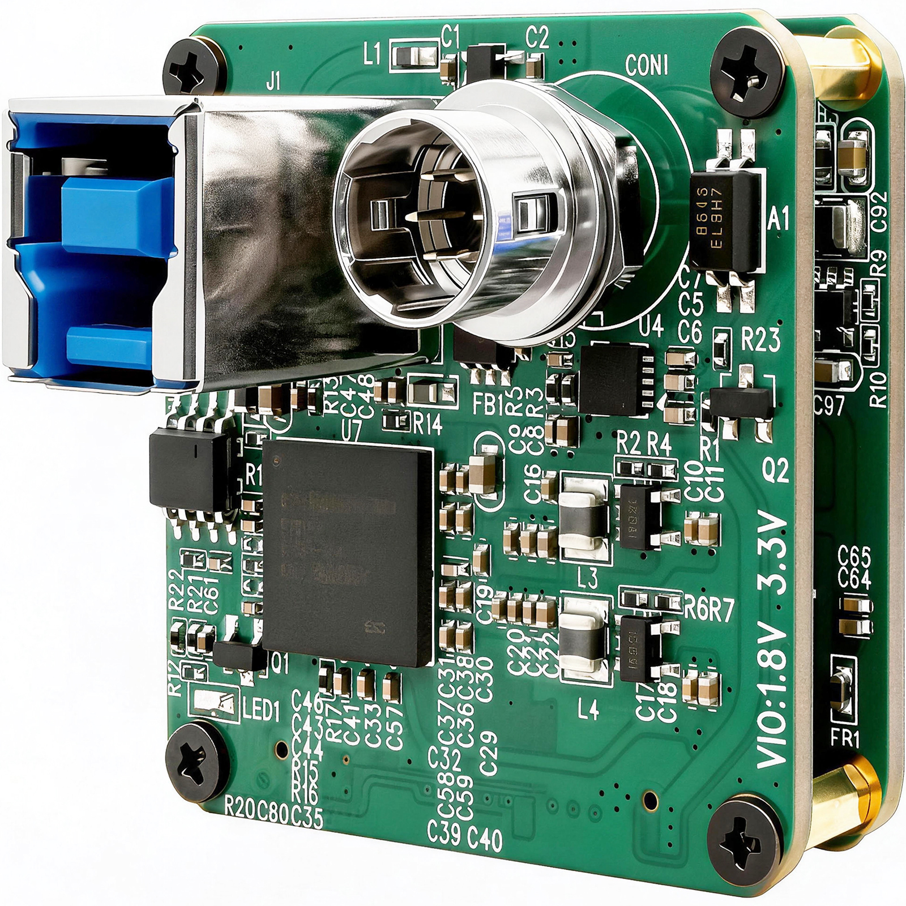

# U3V-CAM-IMX296 USB3 Vision Industrial Camera

The **U3V-CAM-IMX296** is a high-performance USB3 Vision industrial camera featuring the **Sony IMX296LLR** (monochrome) global shutter CMOS sensor. With a resolution of **1.58 MP (1456 × 1088)** and a full-resolution frame rate of **60 fps**, it provides reliable, distortion-free imaging for demanding machine-vision applications such as motion analysis, automation, robotics, and scientific imaging.

The camera is 100% compliant with **USB3 Vision v1.0** and **GenICam 3.x** standards, offering plug-and-play compatibility across all major software platforms.

---

## Key Features

*   **Sony IMX296 Global Shutter Sensor**: 1/2.9" CMOS sensor with 3.45 µm pixels, ensuring zero rolling distortion.
*   **High Frame Rate**: Up to 60 fps at full resolution (1456 × 1088); exceeds 1900 fps with reduced ROI.
*   **True Analog Gain**: 0–48 dB range with 0.1 dB steps for extremely low-noise imaging.
*   **Long Exposure**: Supports manual shutter with true long-exposure capability (≥ 15 seconds).
*   **Precise Synchronization**: Opto-isolated hardware trigger (5–24V) and strobe output with 0.1 µs hardware timestamping.
*   **Industrial Design**: USB 3.0 bus-powered, compact form factor, and on-board temperature monitoring.
*   **Standard Compliance**: Fully compatible with any GenICam-compliant software without proprietary patches.

---

## Specifications

| Feature | Specification |
| :--- | :--- |
| **Sensor** | Sony IMX296LLR (Monochrome, Global Shutter) |
| **Resolution** | 1456 (H) × 1088 (V), 1.58 MP |
| **Pixel Size** | 3.45 µm × 3.45 µm |
| **Max Frame Rate** | 60 fps @ Full ROI (Mono8) |
| **Exposure Time** | 29 µs to ≥ 15 seconds |
| **Analog Gain** | 0 – 48 dB (0.1 dB steps) |
| **Interface** | USB 3.0 (Type-C or Micro-B depending on model) |
| **I/O Connector** | 6-pin Hirose (Trigger In, Strobe Out, GND) |
| **Power** | USB Bus-powered, 5V / ≤ 3.2W |
| **Lens Mount** | M12 (Default) / CS-Mount (Optional) |
| **Operating Temp** | -10 °C to +65 °C |

---

## 1. Hardware

### 6-pin Hirose Connector Pinout (HR10A-7R-6P)

| Pin | Signal | Description |
| :--- | :--- | :--- |
| 1 | GPIO_B33 | Reserved |
| 2 | Trig + | Opto-isolated Trigger Input (+) |
| 3 | GPIO_A33 | Reserved |
| 4 | STROBE + | Opto-isolated Strobe Output (+) |
| 5 | STROBE - / Trig - | Opto-isolated I/O Ground |
| 6 | GND | System Ground |

For detailed hardware dimensions, connector parameters, and wiring diagrams, refer to the [U3V-CAM-IMX296 User Manual V1.2.pdf](./U3V-CAM-IMX296%20User%20Manual%20V1.2.pdf).

---

## 2. InnoMaker SDK

The **InnoMaker U3V SDK** (version 2.3.2) is the recommended choice for developers who need direct, low-level camera access and maximum performance. It provides a lightweight Windows 10/11 x64 C/C++ API and a Windows Python package, both built on the same underlying shared library.

**SDK version**: 2.3.2 — **Last updated**: 2026-08-19

For full installation instructions, package contents, API reference, and code examples, see:

> **[`InnoMaker_SDK/DELIVERY_OVERVIEW.md`](./InnoMaker_SDK/DELIVERY_OVERVIEW.md)**

### Available Packages

| Package | Platform | Description |
| :--- | :--- | :--- |
| [`u3v-sdk-2.3.2-windows-x64.zip`](./InnoMaker_SDK/u3v-sdk-2.3.2-windows-x64.zip) | Windows 10/11 x64 | C/C++ SDK + Qt6 viewer, fully self-contained (~24 MB) |
| [`u3v-sdk-2.3.2-python-windows-x64.zip`](./InnoMaker_SDK/u3v-sdk-2.3.2-python-windows-x64.zip) | Windows 10/11 x64, Python 3.8+ | Python package with the bundled Windows native library (~0.2 MB) |

### Supported Platforms

| Platform | Architecture | Status |
| :--- | :--- | :--- |
| Windows 10 / 11 | x64 | ✅ Fully Supported |

---

## 3. Windows Driver Switching (InnoMaker SDK ↔ eBUS Player)

On Windows, the **InnoMaker SDK** uses the **WinUSB** driver, while **eBUS Player / eBUS SDK** installs its own **Pleora USB** driver. These two drivers are mutually exclusive — only one can be active at a time for the same device.

**Step 1: Uninstall the current driver**

1. Open **Device Manager** (`Win + X` → Device Manager)
2. Locate the camera under **Universal Serial Bus devices** or **Imaging devices**
3. Right-click the device → **Uninstall device**
4. Check **Delete the driver software for this device** (if prompted), then click **Uninstall**
5. Unplug the camera and plug it back in

**Step 2: Install the target driver**

- **Switch to InnoMaker SDK (WinUSB):** Run `tools\zadig-2.9.exe` from the `u3v-sdk-2.3.2-windows-x64` package, select the camera device, choose **WinUSB**, and click **Install Driver**.
- **Switch to eBUS Player (Pleora USB):** Launch the eBUS SDK installer or eBUS Player — it will automatically install the Pleora USB driver on first run.

> **Tip:** If the camera is not recognized after switching, try unplugging and replugging the USB cable, or restart the computer.

---

## 4. Third Party SDK

The U3V-CAM-IMX296 is 100% USB3 Vision / GenICam compliant and works out-of-the-box with any standard-compliant software. The following third-party tools are verified and supported.

### eBus Player (Pleora / JAI)

**eBUS Player** is a full-featured GUI application for controlling GenICam-compliant cameras. It supports live preview, camera parameter adjustment, data logging, and multi-camera management. The **eBUS SDK** additionally provides C++ and Python APIs for custom application development.

**Supported platforms**: Windows 10/11, Linux x86_64, Linux ARM64 (Raspberry Pi 4/5 Bookworm)

**Downloads (official latest):**
- Windows / Linux: [https://www.jai.com/support-software/jetson-ubuntu](https://www.jai.com/support-software/jetson-ubuntu)

**Local package for Raspberry Pi 5** (pre-downloaded, no internet required):
- [`eBusPlayer&Aravis_PI5_Linux/ebus_for_raspberry_pi5/`](./eBusPlayer%26Aravis_PI5_Linux/ebus_for_raspberry_pi5/) — `.deb` installer + quick start guides (C++, .NET, Python, Linux, Pi 4/5)

> **Note**: eBUS SDK requires a Pleora license for production use. Without a license, the viewer and SDK operate in evaluation mode (watermarked output, limited streaming duration).

### Aravis (Open-Source GenICam)

**Aravis** is an open-source GenICam implementation for Linux (GNOME Project), providing a lightweight alternative to eBUS for custom application development.

**Local package for Raspberry Pi 5:**
- [`eBusPlayer&Aravis_PI5_Linux/aravis_for_raspberry_pi5/aravis-0.8.35.tar.xz`](./eBusPlayer%26Aravis_PI5_Linux/aravis_for_raspberry_pi5/)

### Pre-installed OS Image for Raspberry Pi 5

A pre-configured Raspberry Pi 5 OS image with all software (InnoMaker SDK, eBUS Player, Aravis) pre-installed is available for download:

**Download**: [https://www.jianguoyun.com/p/DXuEVqMQpdSrBxiqmp0GIAA](https://www.jianguoyun.com/p/DXuEVqMQpdSrBxiqmp0GIAA)  
**Password**: `uwpui3`

---

## Repository Structure

| Directory / File | Purpose |
| :--- | :--- |
| [`InnoMaker_SDK/`](./InnoMaker_SDK/) | InnoMaker U3V SDK v2.3.2 packages (Windows 10/11 x64 C/C++ SDK and Windows Python package) |
| [`InnoMaker_SDK/DELIVERY_OVERVIEW.md`](./InnoMaker_SDK/DELIVERY_OVERVIEW.md) | Full SDK documentation: package contents, installation, API reference |
| [`InnoMaker_SDK/RELEASE_NOTES.md`](./InnoMaker_SDK/RELEASE_NOTES.md) | SDK changelog and version history |
| [`InnoMaker_SDK/DLL_USAGE.md`](./InnoMaker_SDK/DLL_USAGE.md) | C/C++ and Python library integration guide |
| [`InnoMaker_SDK/TRIGGER_USAGE.md`](./InnoMaker_SDK/TRIGGER_USAGE.md) | External hardware trigger guide (wiring, Arduino, Pi, Jetson, STM32, PLC) |
| [`InnoMaker_SDK/WHATS_NEW.md`](./InnoMaker_SDK/WHATS_NEW.md) | Customer-facing summary of improvements across SDK versions |
| [`InnoMaker_SDK/u3v-sdk-2.3.2-windows-x64.zip`](./InnoMaker_SDK/u3v-sdk-2.3.2-windows-x64.zip) | Windows 10/11 x64 C/C++ SDK + Qt6 viewer, fully self-contained (~24 MB) |
| [`InnoMaker_SDK/u3v-sdk-2.3.2-python-windows-x64.zip`](./InnoMaker_SDK/u3v-sdk-2.3.2-python-windows-x64.zip) | Windows 10/11 x64 Python 3.8+ package with the bundled Windows native library (~0.2 MB) |
| [`eBusPlayer&Aravis_PI5_Linux/`](./eBusPlayer%26Aravis_PI5_Linux/) | eBUS Player and Aravis packages for Raspberry Pi 5 / Linux |
| [`eBusPlayer_Win/`](./eBusPlayer_Win/) | Windows eBUS Player download links |
| [`PreInstalled-IMG-PI5/`](./PreInstalled-IMG-PI5/) | Download link for pre-configured Raspberry Pi 5 OS image |
| [`images/`](./images/) | Product images |
| [`U3V-CAM-IMX296 User Manual V1.2.pdf`](./U3V-CAM-IMX296%20User%20Manual%20V1.2.pdf) | Complete hardware and software documentation |

---

## Support

*   **Website**: [www.inno-maker.com](https://www.inno-maker.com)
*   **GitHub**: [github.com/INNO-MAKER](https://github.com/INNO-MAKER)
*   **Email**: [support@inno-maker.com](mailto:support@inno-maker.com) | [sales@inno-maker.com](mailto:sales@inno-maker.com) | [zoujy@inno-maker.com](mailto:zoujy@inno-maker.com)
